<picture>
  <source media="(prefers-reduced-motion: reduce) and (max-width: 600px)" srcset="docs/readme/hero-mobile.svg">
  <source media="(prefers-reduced-motion: reduce)" srcset="docs/readme/hero.svg">
  <source media="(max-width: 600px)" srcset="docs/readme/motion/hero-mobile.svg">
  
</picture>

Автотесты для [ItemBro](https://github.com/Kriksson/item-bro). API на REST Assured, UI на Selenide. Проверяются регистрация, объявления, заказы, отзывы, чат и права доступа. Запуск через Jenkins -> отдельные стенды в Docker -> результаты в Allure.

<picture>
  <source media="(prefers-reduced-motion: reduce)" srcset="docs/readme/stack/tech-1.svg">
  
</picture>
<picture>
  <source media="(prefers-reduced-motion: reduce)" srcset="docs/readme/stack/tech-2.svg">
  
</picture>
<picture>
  <source media="(prefers-reduced-motion: reduce)" srcset="docs/readme/stack/tech-3.svg">
  
</picture>
<picture>
  <source media="(prefers-reduced-motion: reduce)" srcset="docs/readme/stack/tech-4.svg">
  
</picture>
<picture>
  <source media="(prefers-reduced-motion: reduce)" srcset="docs/readme/stack/tech-5.svg">
  
</picture>
<picture>
  <source media="(prefers-reduced-motion: reduce)" srcset="docs/readme/stack/tech-6.svg">
  
</picture>
<picture>
  <source media="(prefers-reduced-motion: reduce)" srcset="docs/readme/stack/tech-7.svg">
  
</picture>
<picture>
  <source media="(prefers-reduced-motion: reduce)" srcset="docs/readme/stack/tech-8.svg">
  
</picture>
<picture>
  <source media="(prefers-reduced-motion: reduce)" srcset="docs/readme/stack/tech-9.svg">
  
</picture>
<picture>
  <source media="(prefers-reduced-motion: reduce)" srcset="docs/readme/stack/tech-10.svg">
  
</picture>
<picture>
  <source media="(prefers-reduced-motion: reduce)" srcset="docs/readme/stack/tech-11.svg">
  
</picture>

<h2 id="что-проверяется">
<picture>
  <source media="(prefers-reduced-motion: reduce) and (max-width: 600px)" srcset="docs/readme/headings/section-1-mobile.svg">
  <source media="(prefers-reduced-motion: reduce)" srcset="docs/readme/headings/section-1.svg">
  <source media="(max-width: 600px)" srcset="docs/readme/motion/headings/section-1-mobile.svg">
  
</picture>
</h2>

| Область | API | UI |
| --- | --- | --- |
| Авторизация | Регистрация, вход, выход, валидация данных, сессии и CSRF | Формы регистрации и входа, ошибки, сохранение сессии после F5, смена аккаунта |
| Категории и объявления | Права доступа, границы значений, дубликаты категорий, лимит активных объявлений, архивирование | Создание и архивирование категорий администратором; публикация, валидация и архивирование объявлений |
| Заказы | Покупка, баланс, доступ участников, подтверждение покупателем и отмена продавцом | Покупка через интерфейс, недостаточный баланс, подтверждение и возврат денег при отмене |
| Отзывы | Оценка и изменение отзыва, ответ продавца, ограничения по ролям | Отзыв покупателя и ответ продавца |
| Чат заказа | Доступ к сообщениям, валидация текста, повтор запроса без дубля и конфликт идентификатора | Переписка покупателя и продавца без обновления страницы, сохранение истории после F5 |
| Администрирование и профиль | Общий список заказов, повторное открытие и закрытие заказа, возврат денег | Видимость управления по роли; изменение сведений и их отображение в публичном профиле |

API-тесты используют REST Assured, UI-тесты используют Selenide и Page Object. Пользователи и данные для проверок создаются через API и JDBC.

Проверяются обычные сценарии и ошибки: покупка без денег, доступ к чужому заказу, повторная отправка сообщения. Для проверки чата открываются два браузера: покупатель и продавец переписываются без обновления страницы.

<h2 id="jenkins-и-allure">
<picture>
  <source media="(prefers-reduced-motion: reduce) and (max-width: 600px)" srcset="docs/readme/headings/section-2-mobile.svg">
  <source media="(prefers-reduced-motion: reduce)" srcset="docs/readme/headings/section-2.svg">
  <source media="(max-width: 600px)" srcset="docs/readme/motion/headings/section-2-mobile.svg">
  
</picture>
</h2>

Jenkins -> поднимает стенды -> запускает тесты -> собирает Allure Report и удаляет контейнеры.

**Jenkins**

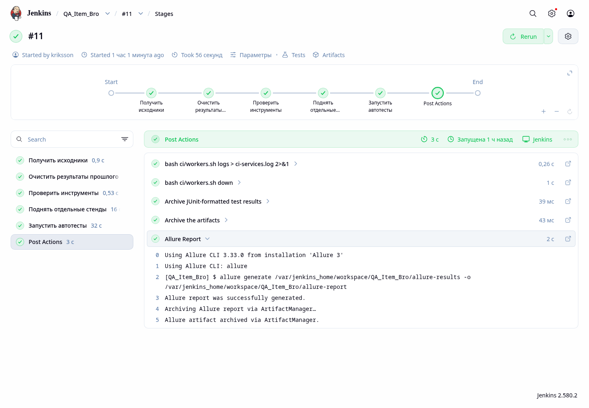

**Allure Report**

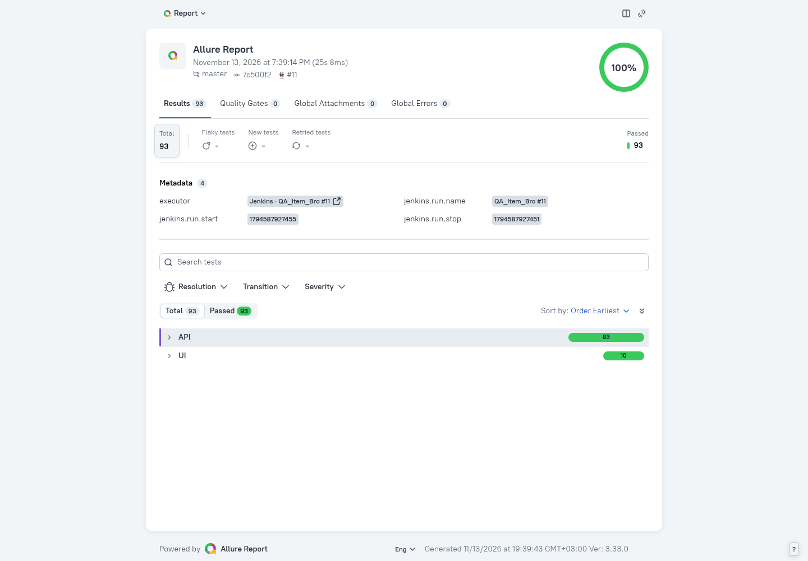

<h2 id="как-устроен-запуск">
<picture>
  <source media="(prefers-reduced-motion: reduce) and (max-width: 600px)" srcset="docs/readme/headings/section-3-mobile.svg">
  <source media="(prefers-reduced-motion: reduce)" srcset="docs/readme/headings/section-3.svg">
  <source media="(max-width: 600px)" srcset="docs/readme/motion/headings/section-3-mobile.svg">
  
</picture>
</h2>

```text
Maven Surefire -> отдельный JVM-процесс worker N
                         │
                         ├── API -> backend N
                         ├── UI  -> Chrome -> frontend N -> backend N
                         └── JDBC -> PostgreSQL N

Jenkins -> Docker Compose -> отдельный комплект сервисов на каждый worker
        -> JUnit + Allure + скриншоты + журналы сервисов
```

При параллельном запуске каждый процесс получает отдельные backend, frontend и базу. Тесты не мешают друг другу при очистке данных.

Количество процессов задаётся через `test.threads`. В каждом процессе тесты идут по очереди. Вместо `{worker}` в адресах API, frontend и БД подставляется номер процесса.

<h2 id="тестовый-стенд">
<picture>
  <source media="(prefers-reduced-motion: reduce) and (max-width: 600px)" srcset="docs/readme/headings/section-4-mobile.svg">
  <source media="(prefers-reduced-motion: reduce)" srcset="docs/readme/headings/section-4.svg">
  <source media="(max-width: 600px)" srcset="docs/readme/motion/headings/section-4-mobile.svg">
  
</picture>
</h2>

Jenkins поднимает backend, frontend и PostgreSQL перед тестами и удаляет их после запуска. Образы приложения, Docker-сеть и Selenoid уже подготовлены в окружении Jenkins.

Перед каждым API-классом и каждым UI-тестом база очищается. Затем создаются тестовые пользователи, назначаются роли и баланс. Остальные данные создаются внутри сценариев.

Подготовка находится в [TestBaseAPI](src/test/java/API/TestBaseAPI.java) и [TestBaseUI](src/test/java/UI/TestBaseUI.java). Все изменения данных выполняются на временных стендах Jenkins.

<h2 id="конфигурация-jenkins">
<picture>
  <source media="(prefers-reduced-motion: reduce) and (max-width: 600px)" srcset="docs/readme/headings/section-5-mobile.svg">
  <source media="(prefers-reduced-motion: reduce)" srcset="docs/readme/headings/section-5.svg">
  <source media="(max-width: 600px)" srcset="docs/readme/motion/headings/section-5-mobile.svg">
  
</picture>
</h2>

[Готовая конфигурация одним архивом](docs/readme/jenkins/jenkins-config.zip) -> pipeline, тестовые стенды и файлы действующего Jenkins.

Полный pipeline находится в корневом [Jenkinsfile](Jenkinsfile). В архив приложена его копия. Это конфигурация текущего стенда: задача получает тесты из `Kriksson/QA_Item_Bro`, ветка `master`.

### Запуск сборки

В задаче **QA_Item_Bro -> Собрать с параметрами** выбираются:

| Параметр | Значения |
| --- | --- |
| `TEST_SUITE` | `ALL`, `API`, `UI` |
| `THREADS` | `1`, `2`, `3`, `4` |

**Собрать** -> проверка инструментов -> подготовка отдельных стендов -> тесты -> отчёты -> удаление стендов.

### Что уже настроено в Jenkins

- JDK 27 по пути `/opt/jdk-27`, Docker CLI и Docker Compose.
- Allure CLI и плагины Pipeline, Git, JUnit, Allure Report и Pipeline Graph View.
- Доступ Jenkins к Docker socket.
- Образы `item-bro-app:latest` и `item-bro-ui-frontend:latest`.
- Docker-сеть `item-bro_default` и Selenoid с Chrome 128.0 по адресу `http://selenoid:4444/wd/hub`.

Образы приложения подготовлены заранее. Перед каждой сборкой Jenkins поднимает из них временные backend, frontend и PostgreSQL, а после тестов удаляет эти стенды.

### Как работает pipeline

1. **Получить исходники.** Загружаются тесты из ветки `master`. Для сборки создаётся свой префикс в именах сервисов.
2. **Очистить результаты прошлого запуска.** Удаляются старые результаты Maven, Allure и Selenide.
3. **Проверить инструменты.** Проверяются Java, Maven Wrapper, Docker, образы приложения и доступность Selenoid.
4. **Поднять отдельные стенды.** Скрипт `ci/workers.sh` запускает нужное количество комплектов сервисов и ждёт их готовности.
5. **Запустить автотесты.** `TEST_SUITE` определяет набор тестов, `THREADS` задаёт число процессов Maven Surefire.
6. **Собрать результаты.** Сохраняются JUnit, Allure, скриншоты и логи сервисов. Стенды удаляются и при падении тестов.

Например, при `TEST_SUITE=ALL` и `THREADS=2` запускаются два процесса. Каждый работает со своими backend, frontend и PostgreSQL. В адресах `API_URL`, `UI_URL` и `DB_URL` вместо `{worker}` подставляется номер процесса.

<details>
<summary>Jenkinsfile целиком</summary>

```groovy
pipeline {
    agent any

    options {
        disableConcurrentBuilds()
        skipDefaultCheckout(true)
        timeout(time: 40, unit: 'MINUTES')
    }

    parameters {
        choice(name: 'TEST_SUITE', choices: ['ALL', 'API', 'UI'], description: 'Какие тесты запустить')
        choice(name: 'THREADS', choices: ['1', '2', '3', '4'], description: 'Количество параллельных процессов.')
    }

    environment {
        JAVA_HOME = '/opt/jdk-27'
        PATH = "${JAVA_HOME}/bin:${env.PATH}"
        APP_IMAGE = 'item-bro-app:latest'
        FRONTEND_IMAGE = 'item-bro-ui-frontend:latest'
        DB_USER = 'kriksson'
        DB_PASSWORD = 'kriksson'
        SELENIDE_REMOTE = 'http://selenoid:4444/wd/hub'
        SELENIDE_HEADLESS = 'true'
        SELENIDE_BROWSER_VERSION = '128.0'
        ITEM_BRO_NETWORK = 'item-bro_default'
    }

    stages {
        stage('Получить исходники') {
            steps {
                git branch: 'master', url: 'https://github.com/Kriksson/QA_Item_Bro'
                script {
                    env.CI_PREFIX = "qa-${env.JOB_BASE_NAME.take(24)}-${env.BUILD_NUMBER}".toLowerCase().replaceAll('[^a-z0-9-]', '-')
                    env.API_URL = "http://${env.CI_PREFIX}-app-{worker}:8080"
                    env.UI_URL = "http://${env.CI_PREFIX}-frontend-{worker}"
                    env.DB_URL = "jdbc:postgresql://${env.CI_PREFIX}-db-{worker}:5432/item_bro"
                }
            }
        }

        stage('Очистить результаты прошлого запуска') {
            steps {
                dir('target') { deleteDir() }
                dir('allure-results') { deleteDir() }
                dir('build/reports/tests') { deleteDir() }
            }
        }

        stage('Проверить инструменты') {
            steps {
                sh '''
                    set -eu
                    java -version
                    ./mvnw -version
                    docker version
                    docker compose version
                    docker image inspect "$APP_IMAGE" "$FRONTEND_IMAGE" > /dev/null
                    remote_base=${SELENIDE_REMOTE%/}
                    remote_base=${remote_base%/wd/hub}
                    curl --fail --silent --show-error --max-time 10 "$remote_base/status"
                '''
            }
        }

        stage('Поднять отдельные стенды') {
            steps {
                sh 'bash ci/workers.sh up'
            }
        }

        stage('Запустить автотесты') {
            steps {
                sh '''
                    set -eu
                    case "$TEST_SUITE" in
                        ALL)
                            ./mvnw -B -Dtest.threads="$THREADS" test
                            ;;
                        API|UI)
                            ./mvnw -B -Dtest.threads="$THREADS" "-Dtest=$TEST_SUITE.*Test" test
                            ;;
                        *)
                            echo 'TEST_SUITE должен быть ALL, API или UI' >&2
                            exit 2
                            ;;
                    esac
                '''
            }
        }
    }

    post {
        always {
            script {
                if (env.CI_PREFIX) {
                    sh returnStatus: true, script: 'bash ci/workers.sh logs > ci-services.log 2>&1'
                    def cleanup = sh returnStatus: true, script: 'bash ci/workers.sh down'
                    if (cleanup != 0) {
                        unstable('Не удалось удалить временные тестовые стенды; см. журнал сборки')
                    }
                }
            }
            junit testResults: 'target/surefire-reports/TEST-*.xml', allowEmptyResults: true
            archiveArtifacts artifacts: 'allure-results/**,build/reports/tests/**,ci-services.log', allowEmptyArchive: true
            allure(
                allureVersion: '3',
                includeProperties: true,
                results: [[path: 'allure-results']]
            )
        }
    }
}
```

</details>

### Файлы готового примера

| Файл | Назначение |
| --- | --- |
| [Jenkinsfile](docs/readme/jenkins/Jenkinsfile) | Полная конфигурация pipeline |
| [compose.workers.yaml](docs/readme/jenkins/ci/compose.workers.yaml) | Отдельные сервисы для каждого процесса |
| [workers.sh](docs/readme/jenkins/ci/workers.sh) | Запуск стендов, сбор логов и удаление контейнеров |
| [Dockerfile Jenkins](docs/readme/jenkins/server/Dockerfile) | Инструменты внутри образа Jenkins |
| [Compose Jenkins и Selenoid](docs/readme/jenkins/server/compose.yaml) | Контейнеры, сеть, порты и Docker socket |
| [browsers.json](docs/readme/jenkins/server/selenoid/browsers.json) | Настройка Chrome в Selenoid |
| [plugins.txt](docs/readme/jenkins/server/plugins.txt) | Версии плагинов действующего Jenkins |

В приложенном Compose указан GID Docker socket `964` из текущего окружения. При переносе на другой компьютер нужно указать его группу Docker socket. Плагины и настройка задачи хранятся в volume Jenkins; Dockerfile устанавливает инструменты, но не создаёт задачу и пользователя. Подробности переноса находятся в [описании конфигурации](docs/readme/jenkins/README.md).

<h2 id="отчёты">
<picture>
  <source media="(prefers-reduced-motion: reduce) and (max-width: 600px)" srcset="docs/readme/headings/section-6-mobile.svg">
  <source media="(prefers-reduced-motion: reduce)" srcset="docs/readme/headings/section-6.svg">
  <source media="(max-width: 600px)" srcset="docs/readme/motion/headings/section-6-mobile.svg">
  
</picture>
</h2>

- `target/surefire-reports/` -> результаты JUnit.
- `allure-results/` -> результаты и шаги Allure.
- `build/reports/tests/` -> материалы Selenide, в том числе скриншоты и HTML при ошибках.
- `ci-services.log` -> журналы временных сервисов, собираемые Jenkins.

В Allure отображаются названия тестов и шаги выполнения. Для UI подключён `AllureSelenide`, для API используются шаги `Allure.step`. HTTP-ответы выводятся в консоль в тех проверках, где включено логирование.

<h2 id="структура">
<picture>
  <source media="(prefers-reduced-motion: reduce) and (max-width: 600px)" srcset="docs/readme/headings/section-7-mobile.svg">
  <source media="(prefers-reduced-motion: reduce)" srcset="docs/readme/headings/section-7.svg">
  <source media="(max-width: 600px)" srcset="docs/readme/motion/headings/section-7-mobile.svg">
  
</picture>
</h2>

```text
src/test/java/API/       API-сценарии, HTTP-утилиты и модели ответов
src/test/java/UI/        UI-сценарии и база Selenide
src/test/java/UI/Pages/  Page Object
src/test/java/UI/Data/   данные для UI-сценариев
src/test/java/config/    адреса стенда, браузер и подстановка worker
src/test/resources/     настройки последовательного JUnit
ci/                     Docker Compose и управление стендами
Jenkinsfile             выбор набора, подготовка стендов и отчёты
```
